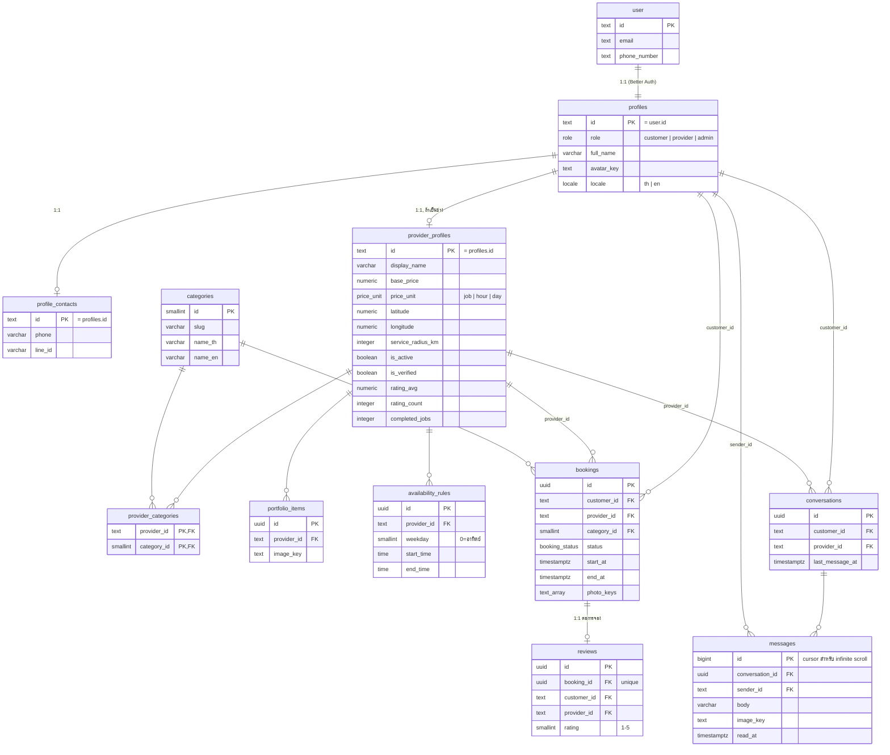
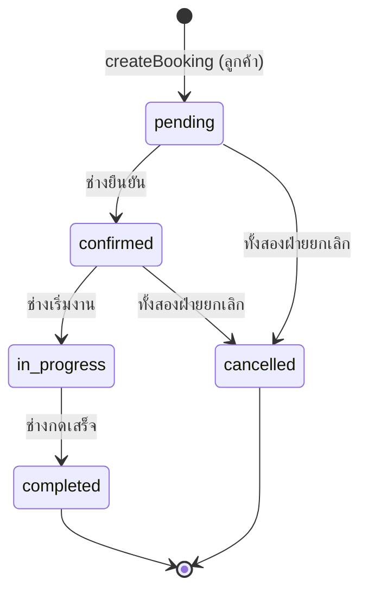
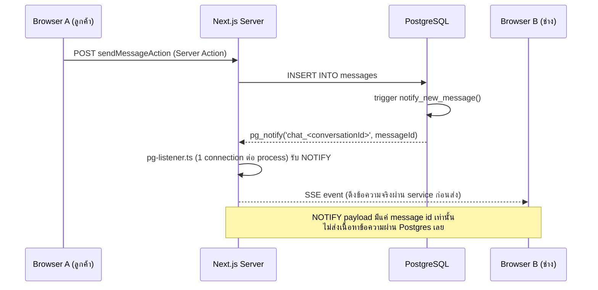

# Architecture — ช่างดี (ChangDee)

## ER Diagram



`user`/`session`/`account`/`verification` เป็นตารางที่ Better Auth จัดการเอง (ไม่แสดงรายละเอียดในแผนภาพนี้)
ดูได้ที่ `src/server/db/auth-schema.ts`

## State Machine: การจอง (`bookings.status`)



กฎสำคัญ (`src/server/services/booking.ts`):

- เปลี่ยนสถานะได้ทางเดียวผ่าน `updateBookingStatus` เท่านั้น ไม่มีทางย้อนกลับ
- ล็อก row ด้วย `SELECT ... FOR UPDATE` ก่อนตรวจสถานะเสมอ (ป้องกัน race ระหว่างสองคำขอพร้อมกัน)
- ยืนยัน (`confirmed`) ชนกับงานอื่นของช่างคนเดียวกันได้ -- DB exclusion constraint `no_double_booking`
  (`EXCLUDE USING gist`) จะปฏิเสธด้วย error code `23P01` ซึ่ง service แปลงเป็น `SLOT_TAKEN`
- ยกเลิกต้องระบุเหตุผล (`cancel_reason`) เสมอ
- เมื่อถึง `completed` จะเพิ่ม `provider_profiles.completed_jobs` ในทรานแซกชันเดียวกัน

## การคุมสิทธิ์ (Authorization)

หลักการหลัก (SPEC.md หัวข้อ 5): **ทุก service function รับ `actor: Actor | null` เป็นพารามิเตอร์แรก
และตรวจสิทธิ์เองข้างใน** -- ไม่มี middleware กลางที่คุมสิทธิ์แทน เพื่อให้เห็นกฎทั้งหมดของแต่ละ
operation อยู่ที่เดียว

```mermaid
flowchart LR
    A[Server Action / Route Handler] -->|"getActor() จาก session"| B[Actor | null]
    B --> C["Service function(actor, input)"]
    C --> D{"ตรวจ role/ownership ข้างใน"}
    D -->|ผ่าน| E["Drizzle query (parameterized)"]
    D -->|ไม่ผ่าน| F["throw AppError(code)"]
```

- **UI ไม่เรียก Drizzle ตรงๆ** -- ESLint (`no-restricted-imports`) บังคับว่า `@/server/db/*` import
  ได้แค่จาก `src/server/**`
- **`role` ไม่รับจาก client โดยตรง** -- `profiles.role` ตั้งค่าเริ่มต้นเป็น `customer` เสมอผ่าน
  Better Auth hook (`databaseHooks.user.create.after`), เปลี่ยนเป็นช่างได้เฉพาะผ่าน `becomeProvider`
- **ซ่อนการมีอยู่ของข้อมูลที่ไม่เกี่ยวกับตัวเอง** -- คนนอกที่ไม่ใช่คู่กรณีของ booking/conversation ได้
  `BOOKING_NOT_FOUND`/`NOT_FOUND` เสมอ ไม่ใช่ `FORBIDDEN` (ไม่บอกว่ามีรายการอยู่จริงแต่ไม่มีสิทธิ์)
- **ข้อมูลติดต่อ (เบอร์/LINE)** เปิดเผยได้เฉพาะผ่าน `getBookingContact` เมื่อ booking ถึงสถานะ
  `confirmed` ขึ้นไปเท่านั้น
- **Rate limiting แบบ in-memory ต่อ process** (`src/server/lib/rate-limit.ts`) -- เพียงพอเพราะแอป deploy
  เป็น single long-running container ไม่ scale แนวนอนใน MVP (ดู PLAN.md ข้อ 5)

## Real-time Chat



- Endpoint: `GET /api/conversations/[id]/stream` -- ตรวจสิทธิ์ (เป็นคู่สนทนาจริง) ก่อนเปิด stream
  เท่านั้น ไม่ตรวจซ้ำทุกข้อความ (ปลอดภัยเพราะ channel ผูกกับ conversation นั้นโดยตรง)
- Heartbeat ทุก 25 วินาที กันไม่ให้ proxy/browser ตัด connection ที่ไม่มีข้อมูลไหลนาน
- จำกัด 20 ข้อความ/นาที/ผู้ใช้ (`RATE_LIMITED`)

## Error Codes

ทุก error code map ไปทั้ง HTTP status และข้อความ th/en ที่ `messages/th.json`/`en.json`
(`src/server/lib/errors.ts`)

| Code                         | HTTP | ความหมาย                                                 |
| ---------------------------- | ---- | -------------------------------------------------------- |
| `UNAUTHORIZED`               | 401  | ยังไม่เข้าสู่ระบบ                                        |
| `FORBIDDEN`                  | 403  | เข้าสู่ระบบแล้วแต่ไม่มีสิทธิ์ทำรายการนี้                 |
| `NOT_FOUND`                  | 404  | ไม่พบข้อมูลที่ต้องการ (ทั่วไป)                           |
| `VALIDATION_ERROR`           | 400  | ข้อมูลที่ส่งมาไม่ผ่าน Zod schema                         |
| `RATE_LIMITED`               | 429  | ทำรายการนี้บ่อยเกินไป                                    |
| `PROVIDER_UNAVAILABLE`       | 409  | ช่างไม่มีอยู่ หรือ `is_active = false`                   |
| `CATEGORY_NOT_OFFERED`       | 409  | ช่างไม่รับงานหมวดที่เลือก                                |
| `INVALID_START_TIME`         | 400  | เวลาเริ่มเร็วกว่า 1 ชม. หรือเกิน 90 วันจากนี้            |
| `OUTSIDE_WORKING_HOURS`      | 409  | เวลาที่เลือกอยู่นอกเวลาทำงานของช่าง                      |
| `TOO_MANY_PENDING_BOOKINGS`  | 409  | ลูกค้ามีคำขอ pending ครบ 5 รายการแล้ว                    |
| `BOOKING_NOT_FOUND`          | 404  | ไม่พบ booking หรือไม่ใช่คู่กรณี (ซ่อนการมีอยู่โดยตั้งใจ) |
| `INVALID_TRANSITION`         | 409  | เปลี่ยนสถานะที่ไม่อยู่ใน state machine                   |
| `CANCEL_REASON_REQUIRED`     | 400  | ยกเลิกโดยไม่ระบุเหตุผล                                   |
| `SLOT_TAKEN`                 | 409  | ยืนยันแล้วเวลาชนกับงานอื่นของช่างคนเดียวกัน              |
| `CONTACT_LOCKED`             | 403  | ยังดูเบอร์/LINE ไม่ได้ (รอ confirmed ขึ้นไป)             |
| `REVIEW_EXISTS`              | 409  | งานนี้ถูกรีวิวไปแล้ว                                     |
| `BOOKING_NOT_COMPLETED`      | 409  | รีวิวได้เฉพาะงานที่เสร็จแล้ว                             |
| `REVIEW_WINDOW_EXPIRED`      | 409  | งานเสร็จมานานเกิน 30 วัน รีวิวไม่ได้แล้ว                 |
| `REVIEW_EDIT_WINDOW_EXPIRED` | 409  | แก้ไขรีวิวได้ภายใน 7 วันหลังเขียนเท่านั้น                |
| `PORTFOLIO_FULL`             | 409  | แกลเลอรีผลงานเต็ม (สูงสุด 30 รูป)                        |

## Known Limitations

- **CSP ใช้ `'unsafe-inline'` สำหรับ script/style** ไม่ได้ทำ nonce ต่อ request -- เพียงพอสำหรับ MVP
  แต่ถ้าต้องการ CSP ที่เข้มกว่านี้ ต้องย้าย inline script (theme toggle, JSON-LD) ไปใช้ nonce ที่สร้างใน
  `src/proxy.ts`
- **Rate limiting เป็น in-memory ต่อ process** ถ้า scale เป็นหลาย container ต้องย้ายไป Redis/Postgres
- **แปล UI เป็นภาษาอังกฤษไม่ครบ 100%** โครงสร้าง i18n (routing, `[locale]` segment, การแปล error
  message) ใช้งานได้จริงแล้ว แต่ข้อความ UI ส่วนใหญ่ยังเป็นภาษาไทยแข็งอยู่ในโค้ด ยังไม่ผ่าน
  `useTranslations` ทุกจุด
